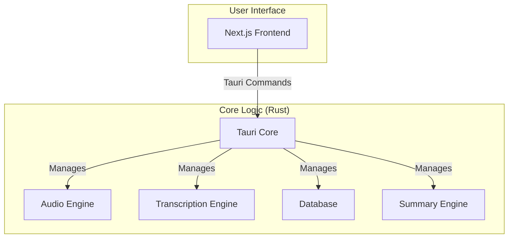

# System Architecture

Samobranka is a self-contained desktop application built with [Tauri](https://tauri.app/). It combines a Rust-based backend with a Next.js frontend into a single, efficient, and cross-platform application.

## High-Level Architecture Diagram

## Component Details

### Frontend (Next.js)

*   Provides the user interface for managing meetings, displaying transcriptions, and configuring the application.
*   Communicates with the Rust core through Tauri's command system.

### Backend (Rust Core)

*   **Tauri Core:** The heart of the application, responsible for managing the window, handling events, and exposing the Rust core to the frontend.
*   **Audio Engine:** Captures audio from the microphone and system, processes it, and prepares it for transcription.
*   **Transcription Engine:** Uses local speech-to-text models through a single engine, [transcribe.cpp](adr/0006-transcribe-cpp-as-fourth-engine.md), integrated in-process through a C ABI (prebuilt transcribe.cpp runtime, Vulkan/CPU compute modes, GGUF model catalog). Speaker diarization is a separate stage performed by the audio.cpp library (Nemotron-3 Diarization model) and is independent of the transcription provider — see [ADR 0001](adr/0001-audio-cpp-as-third-engine.md) (ASR part obsolete) and [ADR 0004](adr/0004-diarization-independent-of-transcription-provider.md).
*   **Database:** A local SQLite database that stores meeting metadata, transcripts, and summaries.
*   **Summary Engine:** Generates meeting summaries using various Large Language Models (LLMs), including local models via Ollama.

## Frontend and Native Communication

The supported application communicates through Tauri commands and events; there is no separate service to run alongside the app.

- Frontend code calls Rust commands with `invoke` from `@tauri-apps/api/core`. Command registration lives in [lib.rs](../frontend/src-tauri/src/lib.rs); implementations delegate to the relevant Rust service.
- Rust emits events through Tauri, and frontend listeners update React state. Check the current command arguments and event payloads before changing either side of the interface.
- The `diarization-progress` channel announces the live stage of a running diarization pass: payload `{meeting_id, stage, progress_percentage?, message}`, with stages `queued`, `decoding`, `loading_model`, `inferring`, `applying_labels` in emission order (the file is decoded before the diarization model loads). `progress_percentage` is present only where it is honestly countable (the model-load and label-write checkpoints) and absent on indeterminate stages. The configuration reasons stay silent on this channel — `no_model`, `no_runtime`, and a pass deferred before it announced anything emit no progress events; a pass that deferred only after announcing `queued` closes itself with the existing `diarization-unavailable` event carrying the `deferred` status, so a watching surface never waits on a terminal that cannot come.
- The import and retranscription bars share one native scale defined in [progress_scale.rs](../frontend/src-tauri/src/audio/progress_scale.rs): transcription runs 30..70, saving owns 70..75, and the native `complete` milestone is 75 — the bottom of the diarization band. The last points (75..100) belong to the frontend: it projects the shared diarization pass state through the band (one slice per stage, in emission order, 100 reserved for the terminal). The frontend mirrors `DIARIZATION_BAND_START` and pins the mirror with a test (`frontend/tests/lib/live-diarization.test.ts`), so neither side may invent a native "100%" while a pass can still run.
- [SidebarProvider.tsx](../frontend/src/components/Sidebar/SidebarProvider.tsx) manages meeting navigation and summary polling, and uses the recording-state context. Preserve the existing state ownership rather than introducing a second source of truth.
- Speaker names have their own interface: the directory and per-meeting assignment tables, four commands, and the `speaker-names-reset` event are documented in [speaker-names.md](speaker-names.md).

## Audio Pipeline

[pipeline.rs](../frontend/src-tauri/src/audio/pipeline.rs) receives asynchronous microphone and system-audio chunks, converts input to mono, resamples when necessary, and buffers samples for mixing.

The mixed audio has two consumers with different requirements:

- **Recording:** mixed audio is sent to [recording_saver.rs](../frontend/src-tauri/src/audio/recording_saver.rs), which uses incremental saving and tracks recording metadata and transcript segments.
- **Transcription:** [vad.rs](../frontend/src-tauri/src/audio/vad.rs) selects speech segments and resamples them for the transcription workers. Silence filtering must not remove audio from the recording output.

The input-processing target is 48 kHz; VAD-selected transcription segments are sent at 16 kHz. Timing and buffering settings belong to the implementation, so inspect the current code rather than assuming a fixed mixing-window duration. During shutdown, the pipeline drains its channel and flushes remaining speech before completing.

On Linux, [pulse_linux.rs](../frontend/src-tauri/src/audio/capture/pulse_linux.rs) captures microphone and system audio through the PulseAudio protocol, including on PipeWire. It dispatches pending mainloop events in bounded nonblocking bursts, sleeping only when idle, so capture can keep up without starving sample delivery or stop checks.

For audio changes, start in the relevant subsystem:

- Device discovery and platform configuration: [devices/](../frontend/src-tauri/src/audio/devices/).
- Stream capture and platform integration: [capture/](../frontend/src-tauri/src/audio/capture/) and [stream.rs](../frontend/src-tauri/src/audio/stream.rs).
- Recording lifecycle: [recording_manager.rs](../frontend/src-tauri/src/audio/recording_manager.rs) and [recording_commands.rs](../frontend/src-tauri/src/audio/recording_commands.rs).
- Mixing and speech segmentation: [pipeline.rs](../frontend/src-tauri/src/audio/pipeline.rs) and [vad.rs](../frontend/src-tauri/src/audio/vad.rs).
- Provider dispatch and transcript emission: [transcription/](../frontend/src-tauri/src/audio/transcription/).

## Transcription and Model Management

Processing a meeting has two stages, and they are independent. **Transcription** is the first stage: it is implemented through the single local provider, transcribe.cpp (`transcribeCpp`), under [audio/transcription/](../frontend/src-tauri/src/audio/transcription/). **Diarization** is the second stage: an offline pass over the finished transcript that overlays speaker turns onto the VAD segment timestamps, whatever provider produced the text. `diarize_saved_meeting` in [diarization_run.rs](../frontend/src-tauri/src/audio/transcription/diarization_run.rs) is the one operation behind every save path (recording stop, import, retranscription, manual run); it decides on its own whether a pass can run, serializes passes process-wide, writes the labels together with the speaker-name recount, and emits the native events. Its preconditions are an installed Nemotron-3 Diarization model and a loadable audio.cpp native library; there is no separate toggle, and a missing precondition degrades to a status (`no_model`, `no_runtime`) instead of failing the save. See [ADR 0004](adr/0004-diarization-independent-of-transcription-provider.md).

transcribe.cpp model discovery, downloads, loading, and compute-mode selection (Auto / Vulkan / CPU) are managed by [transcribe_cpp_engine/](../frontend/src-tauri/src/transcribe_cpp_engine/): `catalog.rs` describes each supported GGUF model (family, quantization, pinned upstream revision, exact size) and `models.rs` owns discovery, download, cancellation and deletion. Model management never loads the native library, so models can be managed before the runtime is staged.

The audio.cpp module ([audio_cpp_engine/](../frontend/src-tauri/src/audio_cpp_engine/)) is diarization-only: its catalog contains the Nemotron-3 Diarization model and its download lifecycle uses the shared [model_downloader.rs](../frontend/src-tauri/src/model_downloader.rs) mechanism, validating the GGUF header plus the exact catalogued size; model state is derived from disk on every query, so it survives restarts. Like transcribe.cpp's manager, it works without the native runtime.

The settings UI shows the Transcribe.CPP model table ([TranscribeCppModelManager.tsx](../frontend/src/components/TranscribeCppModelManager.tsx)) with the compute-mode selector, plus an always-visible "Speaker diarization" section that renders [AudioCppModelManager.tsx](../frontend/src/components/AudioCppModelManager.tsx) for the diarization model only.

Model directories and acceleration behavior depend on application configuration and the staged native runtimes. Use the current initialization and loading code as the source of truth rather than hardcoding storage paths or assuming runtime GPU fallback. See the [build instructions](BUILDING.md) and [GPU acceleration guide](GPU_ACCELERATION.md) for platform setup.
